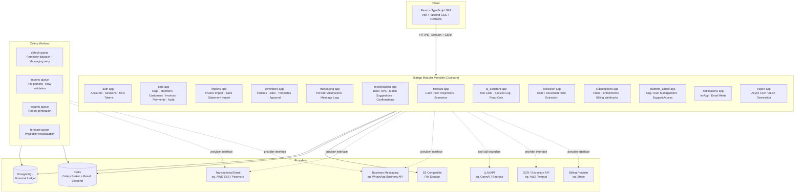
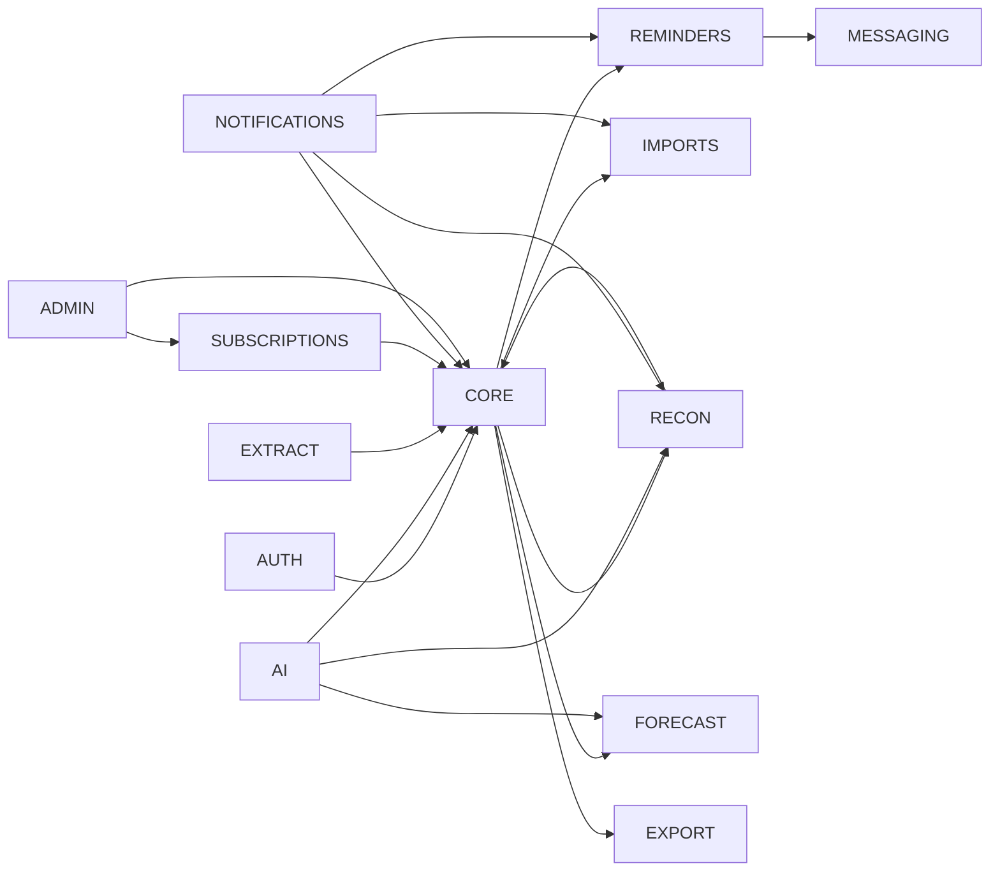

# Design Document

## Overview

FinPilot AI is a multi-tenant B2B SaaS platform for AI-powered receivables management, payment recovery, and cash flow forecasting targeting Indian MSMEs. The platform is structured as a **modular monolith**: a single deployable Django application divided into well-bounded Django apps, each owning its own models, serializers, views, and service logic. The frontend is an independently deployable React + TypeScript SPA that communicates exclusively through the versioned REST API.

### Design Principles

- **PostgreSQL is the authoritative ledger.** All monetary amounts are stored and computed as integer Minor_Units (paise). Binary floating-point arithmetic is never used for financial calculations.
- **AI is read-only and sandboxed.** The AI_Assistant queries data through server-controlled tool functions that enforce the same Organization and role permission checks as the REST API. The AI layer cannot write to the database.
- **Async work is durable, not authoritative.** Celery + Redis handles reminders, imports, exports, and forecasts. The financial effect of any async job is only committed inside a PostgreSQL transaction; Redis is never the source of financial truth.
- **Provider interfaces are replaceable.** Messaging, AI, file storage, email, OCR, and billing are each behind a Python abstract base class. Swapping a provider changes only the concrete implementation class, not calling code.
- **Tenant isolation is enforced at the query layer.** Every queryset is filtered by `organization_id` derived from the server session, never from a client-supplied header alone.

---

## Architecture

### Component Overview



### Module Dependency Map



### Deployment Topology

```
Internet → Nginx (TLS termination + static files) → Gunicorn (Django)
                                                   → Celery Workers (N replicas)
                                                   → Celery Beat (1 replica, reminder scheduler)
PostgreSQL (primary + optional read replica for reports)
Redis (broker + result backend, no financial data)
S3-Compatible bucket (private, pre-signed URLs only)
```

---

## Components and Interfaces

### 2.1 Auth App (`auth` / extended Django auth)

**Responsibilities:** Account creation, session-based sign-in/sign-out, password reset tokens, MFA enrollment, inactive/suspended account blocking, session timeout, and security audit logging.

**Key design decisions:**
- Extends Django's built-in `AbstractUser` with `status` (active, inactive, suspended), `mfa_enrolled` boolean, and `last_seen` timestamp.
- Password reset uses a time-limited single-use token stored in a `PasswordResetToken` table (not emailed as a raw URL parameter that can be intercepted by referrer headers). Token expires after 60 minutes; used tokens are marked consumed, not deleted, to prevent timing attacks.
- Session timeout: Django's `SESSION_COOKIE_AGE` enforces the 30-minute inactive limit via middleware that compares `last_seen` against `now`.
- MFA: TOTP-based via `django-otp`. Business owners, finance managers, and platform admins are blocked from non-enrollment sessions by middleware.
- Security events (sign-in, sign-out, failed attempts, password reset, sign-in from new device) are written to `AuditLog` within the same request transaction.

**Interfaces:**
```
POST /api/v1/auth/register/
POST /api/v1/auth/login/
POST /api/v1/auth/logout/
GET  /api/v1/auth/me/
GET  /api/v1/auth/csrf/
POST /api/v1/auth/password-reset/request/
POST /api/v1/auth/password-reset/confirm/
POST /api/v1/auth/mfa/enroll/
POST /api/v1/auth/mfa/verify/
```

### 2.2 Core App (`core`)

**Responsibilities:** Organizations, Memberships, Customers, Invoices, Invoice Items, Payments, Payment Allocations, and the central Audit Log. This is the financial ledger layer — all monetary calculations live here.

**Key design decisions:**
- All financial writes (invoice creation, payment recording, allocation) execute inside `transaction.atomic()`.
- Invoice total is always server-calculated: `subtotal_minor − discount_minor + tax_minor`. Clients never submit `total_minor` directly.
- Outstanding balance is derived at read time: `max(0, invoice.total_minor − sum(allocation.amount_minor))`. It is not cached in a column to avoid stale balances, but is indexed via a database view for the dashboard query.
- `Membership` carries a `role` field using `TextChoices`; the `HasOrganizationAccess` permission class reads the `X-Organization-ID` header, validates active membership server-side, and attaches `request.membership` for downstream use.
- `AuditLog` rows are created inside the same transaction as the business operation for financial events (Requirement 19.16).

**Interfaces:**
```
GET/POST        /api/v1/organizations/
GET/PATCH       /api/v1/organizations/{id}/
GET/POST        /api/v1/customers/
GET/PUT/PATCH   /api/v1/customers/{id}/
GET/POST        /api/v1/invoices/
GET/PUT/PATCH   /api/v1/invoices/{id}/
POST            /api/v1/invoices/{id}/void/
GET/POST        /api/v1/payments/
GET             /api/v1/payments/{id}/
POST            /api/v1/payments/{id}/allocations/
GET             /api/v1/dashboard/
GET             /api/v1/reports/aging/
GET             /api/v1/audit-logs/
```

### 2.3 Imports App (`imports`)

**Responsibilities:** CSV/XLSX invoice import and bank statement import. Manages `ImportBatch` lifecycle (pending → validating → previewing → committed / failed), row-level validation, preview generation, and commit confirmation.

**Key design decisions:**
- File is stored in S3 immediately on upload. Parsing runs in a Celery task on the `imports` queue so the API returns the `ImportBatch` ID synchronously, and the client polls the status endpoint.
- Deduplication uses a SHA-256 hash of the file content stored on `ImportBatch.file_hash`. A re-upload of the same file returns the existing batch without re-processing.
- Row parsing uses `openpyxl` (XLSX) and the Python standard library `csv` module (CSV). No third-party parsing library is introduced.
- Monetary amounts in import files are treated as decimal values in major currency units (e.g., `1500.50` INR) and converted to Minor_Units by multiplying by 100 and rounding to the nearest integer. The calculated total from line items is compared against the file-supplied total; any discrepancy is flagged.
- Bank statement import uses a column-mapping confirmation step: the API presents detected column names and the user maps them to canonical fields (transaction_date, description, debit_amount, credit_amount, account_identifier) before rows are normalized.

**Interfaces:**
```
GET  /api/v1/imports/invoice-template/          # Download sample CSV/XLSX
POST /api/v1/imports/invoices/                  # Upload file → create ImportBatch
GET  /api/v1/imports/invoices/{batch_id}/       # Poll status + preview rows
POST /api/v1/imports/invoices/{batch_id}/commit/ # Confirm import
POST /api/v1/imports/bank-statements/            # Upload file → create ImportBatch
GET  /api/v1/imports/bank-statements/{batch_id}/
POST /api/v1/imports/bank-statements/{batch_id}/confirm-mapping/
POST /api/v1/imports/bank-statements/{batch_id}/commit/
```

### 2.4 Reminders App (`reminders`)

**Responsibilities:** Reminder policies, reminder templates, reminder jobs, scheduler evaluation, approval queue, and opt-out management.

**Key design decisions:**
- `ReminderPolicy` stores trigger offset (−365 to +365 days relative to due date), channel, template, schedule (cron expression + timezone), approval mode (manual or automatic), max frequency in days, max attempt count, and quiet hours.
- `Celery Beat` runs the scheduler every 15 minutes. The scheduler evaluates all active policies, identifies eligible invoices, and creates `ReminderJob` rows with idempotency keys. A unique constraint on `(policy_id, invoice_id, scheduled_date)` prevents duplicates.
- In manual mode, new jobs enter the `proposed` state and appear in the approval queue. In automatic mode, jobs enter the `scheduled` state and are dispatched by the worker after a final eligibility check.
- Final eligibility check immediately before dispatch verifies: invoice is not paid/void/zero-balance, customer contact is valid, policy is still enabled, and no duplicate send exists. Any failure blocks the send and records a reason.
- Customer opt-out is a boolean flag on the `Customer` model. Setting it to true writes an `AuditLog` entry and immediately excludes the customer from all policy evaluation.

**Interfaces:**
```
GET/POST        /api/v1/reminders/policies/
GET/PUT/PATCH   /api/v1/reminders/policies/{id}/
POST            /api/v1/reminders/policies/{id}/activate-auto/   # Explicit confirmation required
GET/POST        /api/v1/reminders/templates/
GET/PUT/PATCH   /api/v1/reminders/templates/{id}/
GET             /api/v1/reminders/jobs/              # Approval queue + history
POST            /api/v1/reminders/jobs/{id}/approve/
POST            /api/v1/reminders/jobs/{id}/reject/
POST            /api/v1/customers/{id}/opt-out/
```

### 2.5 Messaging App (`messaging`)

**Responsibilities:** Provider abstraction layer for outbound email and business messaging, message log management, webhook processing, and retry orchestration.

**Key design decisions:**
- `MessagingService` is an abstract base class with a single `send(message: OutboundMessage) -> ProviderResult` method. Concrete implementations: `EmailProvider` (using SES/Postmark), `WhatsAppProvider`. New channels add a new concrete class and a channel registry entry — no calling code changes.
- `MessageLog` captures the full delivery lifecycle: queued → sent → delivered / failed / cancelled / unknown. State transitions are only forward (no going back from `delivered`).
- Webhook endpoints verify the provider signature (HMAC-SHA256) and reject events with timestamps older than 300 seconds.
- Exponential backoff retry: first retry at 30s, then 60s, 120s, 240s, 480s (capped at 1800s), max 5 attempts. Implemented as Celery `countdown` on re-queue.
- Provider credentials are loaded exclusively from environment variables; they are never written to the database.

**Interfaces:**
```
POST /api/v1/webhooks/email/           # Provider webhook (signature verified)
POST /api/v1/webhooks/messaging/       # Provider webhook (signature verified)
GET  /api/v1/messaging/logs/           # Message log history for org
GET  /api/v1/messaging/logs/{id}/
```

**Abstract interface:**
```python
class MessagingProvider(ABC):
    @abstractmethod
    def send(self, message: OutboundMessage) -> ProviderResult: ...

    @abstractmethod
    def verify_webhook(self, payload: bytes, signature: str) -> bool: ...
```

### 2.6 Reconciliation App (`reconciliation`)

**Responsibilities:** Staging bank transactions, deterministic and fuzzy matching, Reconciliation_Match management, and confirmed payment allocation creation.

**Key design decisions:**
- `BankTransaction` rows live in a staging table (`bank_transactions`). They are never automatically promoted to confirmed `Payment` records — only explicit user confirmation of a `ReconciliationMatch` triggers the creation of a `PaymentAllocation` via the same audited financial workflow as manual payment recording.
- Matching pipeline runs in two stages: (1) deterministic rules (exact payment reference, exact invoice number in narration, exact amount + date), then (2) fuzzy scoring (Levenshtein on reference, amount within ±1%, date within ±3 days). Fuzzy matches carry a numeric confidence score and an evidence list.
- One `BankTransaction` can link to multiple `ReconciliationMatch` rows (one per invoice for split settlements).
- Partial settlement: `ReconciliationMatch.amount_minor` can be less than `BankTransaction.amount_minor`.
- A `BankTransaction.allocated_minor` running total prevents over-allocation beyond the transaction amount.

**Interfaces:**
```
GET  /api/v1/reconciliation/transactions/
GET  /api/v1/reconciliation/transactions/{id}/
GET  /api/v1/reconciliation/matches/              # Pending suggestions
POST /api/v1/reconciliation/matches/{id}/confirm/
POST /api/v1/reconciliation/matches/{id}/reject/
```

### 2.7 Forecast App (`forecast`)

**Responsibilities:** Cash inflow forecasting with three scenarios (conservative, base, optimistic), historical delay analysis, and forecast recalculation triggers.

**Key design decisions:**
- `CashForecast` is generated on demand and stored with a snapshot of qualifying invoice IDs, assumptions, and generation timestamp. Subsequent requests within the same day may return the cached snapshot unless a triggering event (new invoice, payment, allocation) has occurred since last generation.
- Payment timing assumptions: `due_date` (no offset), `historical_delay` (derived from confirmed payments), `custom_offset` (user-supplied integer days).
- `historical_delay` requires at least 10 confirmed paid invoices with payment dates in the preceding 12 months. If insufficient data, the scenario falls back to rule-based values (+14 days conservative, 0 base, −7 days optimistic) and sets `insufficient_history = True`.
- Forecast recalculation is triggered by Django signals on `Invoice.post_save` and `PaymentAllocation.post_save`, enqueuing a Celery task on the `forecast` queue.
- Invoices with `status` in (Draft, Void, Paid) are excluded from forecast input.

**Interfaces:**
```
GET  /api/v1/forecast/                  # Current forecast or generate
POST /api/v1/forecast/generate/         # Force recalculation
GET  /api/v1/forecast/{id}/             # Specific forecast snapshot
GET  /api/v1/forecast/{id}/invoices/    # Contributing invoice detail
```

### 2.8 AI Assistant App (`ai_assistant`)

**Responsibilities:** Conversational financial Q&A over Organization data using server-controlled tool calls to the API data layer. Read-only in the initial release.

**Key design decisions:**
- The AI_Assistant communicates with the LLM API through an `AIService` interface. Tool calls (function calling) are defined server-side and each tool enforces Organization + role permission checks before returning data.
- Tool functions call existing service layer methods — they do not issue raw SQL or connect directly to the database. The AI layer never receives a database connection or ORM queryset object.
- Financial values (totals, balances, counts) returned in AI responses are taken verbatim from tool call results; the LLM is instructed not to recompute or adjust them.
- Each session logs `(org_id, user_id, session_id, timestamp, tools_invoked[], response_status)` to `AISessionLog`. Question text and answer content are not stored in the minimum log record.
- Prompt injection defence: user-supplied text (invoice notes, customer names, transaction descriptions) is treated as data arguments to tool calls, never concatenated into the system prompt.
- If any tool call returns records from a different Organization, the result is discarded server-side before being passed to the LLM context.

**Abstract interface:**
```python
class AIService(ABC):
    @abstractmethod
    def chat(self, session: AISession, tools: list[ToolDefinition]) -> AIResponse: ...
```

**Interfaces:**
```
POST /api/v1/ai/chat/           # Submit question, get answer
GET  /api/v1/ai/sessions/       # Session history
GET  /api/v1/ai/sessions/{id}/  # Session detail
```

### 2.9 Extraction App (`extraction`)

**Responsibilities:** Optional AI-assisted document field extraction from PDF/PNG/JPEG uploads for invoice creation pre-fill.

**Key design decisions:**
- `ExtractionService` is an abstract interface. The initial concrete implementation delegates to AWS Textract or a similar OCR API.
- Extracted fields are stored in `ExtractionResult` with per-field `confidence` and `flag` (low_confidence, missing, conflicting). No `Invoice` record is created from an extraction result without explicit user confirmation.
- The source document is stored in S3 under Organization-scoped access controls and linked to the `ExtractionResult`. It is never exposed cross-Organization.
- Monetary amounts from extraction are always treated as candidate values requiring confirmation before ledger write.

**Interfaces:**
```
POST /api/v1/extraction/documents/          # Upload document
GET  /api/v1/extraction/documents/{id}/     # Get extraction result + review form data
POST /api/v1/extraction/documents/{id}/confirm/ # Submit confirmed fields → create Invoice
```

### 2.10 Subscriptions App (`subscriptions`)

**Responsibilities:** Plan definitions, entitlement enforcement, subscription lifecycle, and billing webhook processing.

**Key design decisions:**
- `PlanDefinition` rows in the database define plan names, limits (user count, invoice count, monthly message volume, monthly AI requests), and features. No limits are hardcoded in application code.
- Entitlement checks are implemented as a `check_entitlement(org, limit_type)` function called at the API layer before executing a billable operation.
- Billing provider webhooks are verified by signature and processed idempotently using the provider event ID as a unique key on `BillingEvent`.
- The `BillingProvider` abstract interface has `create_subscription`, `cancel_subscription`, and `process_webhook_event` methods.

**Interfaces:**
```
GET  /api/v1/subscriptions/current/
GET  /api/v1/subscriptions/plans/
POST /api/v1/subscriptions/subscribe/
POST /api/v1/webhooks/billing/       # Billing provider webhook
```

### 2.11 Platform Admin App (`platform_admin`)

**Responsibilities:** Cross-Organization Organization and User management, plan definition editing, support access with audit trail, and background job monitoring.

**Key design decisions:**
- Platform admin endpoints are protected by a separate `IsPlatformAdmin` permission class that checks `user.is_staff` (or a `platform_admin` flag) independent of Organization membership.
- Support access requires an explicit authorization action, grants read-only access scoped to the target Organization for a maximum of 24 hours, and is fully audit-logged with start and end timestamps.
- Plan definition edits write to `PlanDefinition` rows and create `AuditLog` entries with before/after values.

**Interfaces:**
```
GET/PATCH   /api/v1/admin/organizations/
GET/PATCH   /api/v1/admin/users/
GET/PUT     /api/v1/admin/plans/
POST        /api/v1/admin/support-access/
GET         /api/v1/admin/jobs/
```

### 2.12 Notifications App (`notifications`)

**Responsibilities:** In-app notification center, notification preference management, and deduplication.

**Key design decisions:**
- Notifications are created by calling a `create_notification(user, event_type, entity_id, org_id)` service function from any app. Deduplication checks for an existing unresolved notification with the same `(event_type, entity_id, org_id)` before inserting.
- Notification subject lines and push preview text are restricted to event type, entity type, and date — no amounts, customer names, or payment references.
- User preference rows `NotificationPreference(user, org, event_type, enabled)` gate creation: if the user has disabled a type, `create_notification` skips the insert.
- In-app delivery is via a polling endpoint or WebSocket (initial release uses polling).

**Interfaces:**
```
GET  /api/v1/notifications/
POST /api/v1/notifications/{id}/read/
GET  /api/v1/notifications/preferences/
PUT  /api/v1/notifications/preferences/
```

### 2.13 Export App (`export`)

**Responsibilities:** Asynchronous CSV/XLSX generation for Invoices, Payments, Customers, receivables reports, reminder logs, and reconciliation results.

**Key design decisions:**
- Exports with more than 1000 rows are automatically delegated to a Celery task on the `exports` queue. The API returns an `ExportJob` ID; the client polls for completion.
- Completed exports are written to S3 with a pre-signed download URL valid for 60 minutes (not 15 minutes, per Requirement 22.4). Upload access controls are Organization-scoped.
- All exports apply the same Organization scoping and permission checks as the corresponding data view.
- Export completion and the audit trail entry are created in the same database transaction.

**Interfaces:**
```
POST /api/v1/exports/                   # Request export
GET  /api/v1/exports/{id}/              # Poll status
GET  /api/v1/exports/{id}/download/     # Get pre-signed URL
```

---

## Data Models

### Overview

All models extend the existing `core` app schema. New models are distributed across their owning apps. Every tenant-owned table carries an `organization` ForeignKey. UUIDs are used as primary keys for all externally addressable entities. Money is stored as `BigIntegerField` (Minor_Units / paise). Timestamps use `DateTimeField(auto_now_add=True)` (UTC stored, Organization timezone applied at display time).

### Extended Core Models

```python
# Additions to core/models.py

class Organization(models.Model):
    # Existing fields +
    trading_name = models.CharField(max_length=255, blank=True)
    business_email = models.EmailField(blank=True)
    contact_phone = models.CharField(max_length=32, blank=True)
    reporting_date = models.DateField(null=True, blank=True)  # Defaults to today if null

class InvoiceItem(models.Model):
    id = models.UUIDField(primary_key=True, default=uuid.uuid4, editable=False)
    invoice = models.ForeignKey(Invoice, on_delete=models.CASCADE, related_name="items")
    description = models.CharField(max_length=255)
    quantity = models.DecimalField(max_digits=12, decimal_places=3)
    unit_price_minor = models.BigIntegerField()
    line_total_minor = models.BigIntegerField()  # Server-calculated: quantity × unit_price, rounded to nearest paise

class Customer(models.Model):
    # Existing fields +
    opt_out = models.BooleanField(default=False)
    opt_out_recorded_at = models.DateTimeField(null=True, blank=True)
```

### New Models by App

#### Auth Models (`auth` app)

```python
class UserProfile(models.Model):
    user = models.OneToOneField(settings.AUTH_USER_MODEL, on_delete=models.CASCADE)
    status = models.CharField(max_length=16, choices=[("active","Active"),("inactive","Inactive"),("suspended","Suspended")], default="active")
    mfa_enrolled = models.BooleanField(default=False)
    last_seen = models.DateTimeField(null=True, blank=True)
    failed_login_attempts = models.PositiveSmallIntegerField(default=0)
    last_failed_login = models.DateTimeField(null=True, blank=True)

class PasswordResetToken(models.Model):
    id = models.UUIDField(primary_key=True, default=uuid.uuid4, editable=False)
    user = models.ForeignKey(settings.AUTH_USER_MODEL, on_delete=models.CASCADE)
    token_hash = models.CharField(max_length=64, unique=True)  # SHA-256 of raw token
    created_at = models.DateTimeField(auto_now_add=True)
    expires_at = models.DateTimeField()
    used_at = models.DateTimeField(null=True, blank=True)
```

#### Import Models (`imports` app)

```python
class ImportBatch(models.Model):
    class BatchType(models.TextChoices):
        INVOICE = "invoice"
        BANK_STATEMENT = "bank_statement"
    class Status(models.TextChoices):
        PENDING = "pending"
        VALIDATING = "validating"
        PREVIEWING = "previewing"
        COMMITTED = "committed"
        FAILED = "failed"

    id = models.UUIDField(primary_key=True, default=uuid.uuid4, editable=False)
    organization = models.ForeignKey(Organization, on_delete=models.CASCADE)
    batch_type = models.CharField(max_length=20, choices=BatchType.choices)
    status = models.CharField(max_length=16, choices=Status.choices, default=Status.PENDING)
    file_key = models.CharField(max_length=512)          # S3 object key
    file_hash = models.CharField(max_length=64)          # SHA-256, for dedup
    file_name = models.CharField(max_length=255)
    file_size_bytes = models.PositiveIntegerField()
    submitted_by = models.ForeignKey(settings.AUTH_USER_MODEL, on_delete=models.PROTECT)
    created_at = models.DateTimeField(auto_now_add=True)
    completed_at = models.DateTimeField(null=True, blank=True)
    row_count = models.PositiveIntegerField(default=0)
    created_count = models.PositiveIntegerField(default=0)
    rejected_count = models.PositiveIntegerField(default=0)
    skipped_count = models.PositiveIntegerField(default=0)
    flagged_count = models.PositiveIntegerField(default=0)
    error_message = models.TextField(blank=True)

    class Meta:
        constraints = [models.UniqueConstraint(fields=["organization","file_hash"], name="unique_import_file_per_org")]

class ImportRow(models.Model):
    class RowStatus(models.TextChoices):
        VALID = "valid"
        ERROR = "error"
        DUPLICATE_FLAGGED = "duplicate_flagged"
        SKIPPED = "skipped"
        COMMITTED = "committed"

    id = models.UUIDField(primary_key=True, default=uuid.uuid4, editable=False)
    batch = models.ForeignKey(ImportBatch, on_delete=models.CASCADE, related_name="rows")
    row_number = models.PositiveIntegerField()
    status = models.CharField(max_length=20, choices=RowStatus.choices)
    raw_data = models.JSONField()
    parsed_data = models.JSONField(null=True, blank=True)
    errors = models.JSONField(default=list)              # [{field, message}]
    created_invoice = models.ForeignKey("core.Invoice", on_delete=models.SET_NULL, null=True, blank=True)
```

#### Reminder Models (`reminders` app)

```python
class ReminderTemplate(models.Model):
    id = models.UUIDField(primary_key=True, default=uuid.uuid4, editable=False)
    organization = models.ForeignKey(Organization, on_delete=models.CASCADE)
    name = models.CharField(max_length=255)
    channel = models.CharField(max_length=16)            # email, whatsapp
    subject = models.CharField(max_length=255, blank=True)
    body = models.TextField()
    created_by = models.ForeignKey(settings.AUTH_USER_MODEL, on_delete=models.PROTECT)
    created_at = models.DateTimeField(auto_now_add=True)
    current_version = models.PositiveIntegerField(default=1)
    pending_revision = models.ForeignKey("ReminderTemplateRevision", null=True, blank=True, on_delete=models.SET_NULL, related_name="+")

class ReminderTemplateRevision(models.Model):
    id = models.UUIDField(primary_key=True, default=uuid.uuid4, editable=False)
    template = models.ForeignKey(ReminderTemplate, on_delete=models.CASCADE, related_name="revisions")
    version = models.PositiveIntegerField()
    previous_subject = models.CharField(max_length=255, blank=True)
    previous_body = models.TextField()
    changed_by = models.ForeignKey(settings.AUTH_USER_MODEL, on_delete=models.PROTECT)
    changed_at = models.DateTimeField(auto_now_add=True)
    approved_by = models.ForeignKey(settings.AUTH_USER_MODEL, on_delete=models.PROTECT, null=True, blank=True, related_name="+")
    approved_at = models.DateTimeField(null=True, blank=True)
    # Retained for minimum 90 days (enforced by data retention policy, not auto-deletion)

class ReminderPolicy(models.Model):
    class ApprovalMode(models.TextChoices):
        MANUAL = "manual"
        AUTOMATIC = "automatic"

    id = models.UUIDField(primary_key=True, default=uuid.uuid4, editable=False)
    organization = models.ForeignKey(Organization, on_delete=models.CASCADE)
    name = models.CharField(max_length=255)
    applicable_statuses = models.JSONField()             # ["issued","partially_paid","overdue"]
    trigger_offset_days = models.SmallIntegerField()     # -365 to +365
    channel = models.CharField(max_length=16)
    template = models.ForeignKey(ReminderTemplate, on_delete=models.PROTECT)
    schedule_cron = models.CharField(max_length=100)
    schedule_timezone = models.CharField(max_length=64)
    approval_mode = models.CharField(max_length=16, choices=ApprovalMode.choices, default=ApprovalMode.MANUAL)
    max_frequency_days = models.PositiveSmallIntegerField()
    max_attempt_count = models.PositiveSmallIntegerField()
    quiet_hours_start = models.TimeField(null=True, blank=True)
    quiet_hours_end = models.TimeField(null=True, blank=True)
    excluded_customers = models.ManyToManyField("core.Customer", blank=True, related_name="excluded_from_policies")
    enabled = models.BooleanField(default=True)
    auto_mode_confirmed_by = models.ForeignKey(settings.AUTH_USER_MODEL, on_delete=models.PROTECT, null=True, blank=True, related_name="+")
    created_at = models.DateTimeField(auto_now_add=True)

class ReminderJob(models.Model):
    class JobStatus(models.TextChoices):
        PROPOSED = "proposed"
        SCHEDULED = "scheduled"
        APPROVED = "approved"
        REJECTED = "rejected"
        DISPATCHED = "dispatched"
        BLOCKED = "blocked"
        FAILED = "failed"

    id = models.UUIDField(primary_key=True, default=uuid.uuid4, editable=False)
    organization = models.ForeignKey(Organization, on_delete=models.CASCADE)
    policy = models.ForeignKey(ReminderPolicy, on_delete=models.PROTECT)
    invoice = models.ForeignKey("core.Invoice", on_delete=models.PROTECT)
    customer = models.ForeignKey("core.Customer", on_delete=models.PROTECT)
    status = models.CharField(max_length=16, choices=JobStatus.choices, default=JobStatus.PROPOSED)
    idempotency_key = models.CharField(max_length=64, unique=True)   # SHA-256(policy_id+invoice_id+scheduled_date)
    scheduled_date = models.DateField()
    outstanding_minor = models.BigIntegerField()         # Snapshot at job creation
    message_log = models.ForeignKey("messaging.MessageLog", on_delete=models.PROTECT, null=True, blank=True)
    approved_by = models.ForeignKey(settings.AUTH_USER_MODEL, on_delete=models.PROTECT, null=True, blank=True, related_name="+")
    approved_at = models.DateTimeField(null=True, blank=True)
    block_reason = models.CharField(max_length=255, blank=True)
    created_at = models.DateTimeField(auto_now_add=True)

    class Meta:
        constraints = [
            models.UniqueConstraint(fields=["policy","invoice","scheduled_date"], name="unique_reminder_job_per_policy_invoice_date")
        ]
```

#### Messaging Models (`messaging` app)

```python
class MessageLog(models.Model):
    class DeliveryStatus(models.TextChoices):
        QUEUED = "queued"
        SENT = "sent"
        DELIVERED = "delivered"
        FAILED = "failed"
        CANCELLED = "cancelled"
        UNKNOWN = "unknown"

    id = models.UUIDField(primary_key=True, default=uuid.uuid4, editable=False)
    organization = models.ForeignKey(Organization, on_delete=models.CASCADE)
    invoice = models.ForeignKey("core.Invoice", on_delete=models.PROTECT, null=True, blank=True)
    customer = models.ForeignKey("core.Customer", on_delete=models.PROTECT)
    channel = models.CharField(max_length=16)
    template = models.ForeignKey("reminders.ReminderTemplate", on_delete=models.PROTECT, null=True, blank=True)
    status = models.CharField(max_length=16, choices=DeliveryStatus.choices, default=DeliveryStatus.QUEUED)
    provider_message_id = models.CharField(max_length=255, blank=True)
    provider_error = models.CharField(max_length=512, blank=True)
    dispatch_timestamp = models.DateTimeField(auto_now_add=True)
    delivered_at = models.DateTimeField(null=True, blank=True)
    failed_at = models.DateTimeField(null=True, blank=True)
    retry_count = models.PositiveSmallIntegerField(default=0)
    approved_by = models.ForeignKey(settings.AUTH_USER_MODEL, on_delete=models.PROTECT, null=True, blank=True, related_name="+")
    approved_at = models.DateTimeField(null=True, blank=True)
    edited_by = models.ForeignKey(settings.AUTH_USER_MODEL, on_delete=models.PROTECT, null=True, blank=True, related_name="+")
    edited_at = models.DateTimeField(null=True, blank=True)
    edited_fields = models.JSONField(default=list)
    credential_failure_reason = models.CharField(max_length=255, blank=True)
```

#### Reconciliation Models (`reconciliation` app)

```python
class BankTransaction(models.Model):
    id = models.UUIDField(primary_key=True, default=uuid.uuid4, editable=False)
    organization = models.ForeignKey(Organization, on_delete=models.CASCADE)
    import_batch = models.ForeignKey("imports.ImportBatch", on_delete=models.PROTECT)
    account_identifier = models.CharField(max_length=64)
    transaction_date = models.DateField()
    value_date = models.DateField(null=True, blank=True)
    description = models.TextField()
    reference = models.CharField(max_length=255, blank=True)
    debit_minor = models.BigIntegerField(default=0)
    credit_minor = models.BigIntegerField(default=0)
    currency = models.CharField(max_length=3)
    allocated_minor = models.BigIntegerField(default=0)  # Running total of confirmed allocations
    is_probable_duplicate = models.BooleanField(default=False)
    created_at = models.DateTimeField(auto_now_add=True)

    class Meta:
        indexes = [models.Index(fields=["organization", "transaction_date", "account_identifier"])]

class ReconciliationMatch(models.Model):
    class MatchStatus(models.TextChoices):
        SUGGESTED = "suggested"
        CONFIRMED = "confirmed"
        REJECTED = "rejected"

    class MatchMethod(models.TextChoices):
        EXACT = "exact"
        FUZZY = "fuzzy"

    id = models.UUIDField(primary_key=True, default=uuid.uuid4, editable=False)
    organization = models.ForeignKey(Organization, on_delete=models.CASCADE)
    transaction = models.ForeignKey(BankTransaction, on_delete=models.PROTECT, related_name="matches")
    invoice = models.ForeignKey("core.Invoice", on_delete=models.PROTECT, null=True, blank=True)
    payment = models.ForeignKey("core.Payment", on_delete=models.PROTECT, null=True, blank=True)
    amount_minor = models.BigIntegerField()
    match_method = models.CharField(max_length=8, choices=MatchMethod.choices)
    confidence_score = models.DecimalField(max_digits=5, decimal_places=4, null=True, blank=True)  # 0.0–1.0
    evidence = models.JSONField(default=list)            # [{field, matched_value, score}]
    status = models.CharField(max_length=16, choices=MatchStatus.choices, default=MatchStatus.SUGGESTED)
    reviewed_by = models.ForeignKey(settings.AUTH_USER_MODEL, on_delete=models.PROTECT, null=True, blank=True)
    reviewed_at = models.DateTimeField(null=True, blank=True)
    created_payment_allocation = models.ForeignKey("core.PaymentAllocation", on_delete=models.PROTECT, null=True, blank=True)
```

#### Forecast Models (`forecast` app)

```python
class CashForecast(models.Model):
    class TimingAssumption(models.TextChoices):
        DUE_DATE = "due_date"
        HISTORICAL_DELAY = "historical_delay"
        CUSTOM_OFFSET = "custom_offset"

    id = models.UUIDField(primary_key=True, default=uuid.uuid4, editable=False)
    organization = models.ForeignKey(Organization, on_delete=models.CASCADE)
    period_days = models.PositiveSmallIntegerField()     # 7, 30, or 60
    timing_assumption = models.CharField(max_length=20, choices=TimingAssumption.choices)
    custom_offset_days = models.SmallIntegerField(null=True, blank=True)
    generated_at = models.DateTimeField(auto_now_add=True)
    generated_by = models.ForeignKey(settings.AUTH_USER_MODEL, on_delete=models.PROTECT)
    invoice_count = models.PositiveIntegerField()
    invoice_ids = models.JSONField()                     # [uuid strings]
    insufficient_history = models.BooleanField(default=False)

    # Scenario amounts
    conservative_minor = models.BigIntegerField()
    conservative_assumptions = models.JSONField()
    base_minor = models.BigIntegerField()
    base_assumptions = models.JSONField()
    optimistic_minor = models.BigIntegerField()
    optimistic_assumptions = models.JSONField()

class ForecastInvoiceLine(models.Model):
    forecast = models.ForeignKey(CashForecast, on_delete=models.CASCADE, related_name="lines")
    invoice = models.ForeignKey("core.Invoice", on_delete=models.PROTECT)
    customer_name = models.CharField(max_length=200)    # Snapshot
    invoice_number = models.CharField(max_length=64)    # Snapshot
    outstanding_minor = models.BigIntegerField()         # Snapshot at generation time
    due_date = models.DateField()
    conservative_expected_date = models.DateField()
    base_expected_date = models.DateField()
    optimistic_expected_date = models.DateField()
    excluded = models.BooleanField(default=False)
    exclusion_reason = models.CharField(max_length=255, blank=True)
```

#### Subscription Models (`subscriptions` app)

```python
class PlanDefinition(models.Model):
    name = models.CharField(max_length=64, unique=True)  # Starter, Growth, Business, Enterprise
    max_users = models.PositiveIntegerField(null=True, blank=True)
    max_invoices = models.PositiveIntegerField(null=True, blank=True)
    max_messages_per_month = models.PositiveIntegerField(null=True, blank=True)
    max_ai_requests_per_month = models.PositiveIntegerField(null=True, blank=True)
    features = models.JSONField(default=dict)
    updated_at = models.DateTimeField(auto_now=True)

class Subscription(models.Model):
    class SubscriptionStatus(models.TextChoices):
        TRIAL = "trial"
        ACTIVE = "active"
        PAST_DUE = "past_due"
        CANCELLED = "cancelled"
        EXPIRED = "expired"

    id = models.UUIDField(primary_key=True, default=uuid.uuid4, editable=False)
    organization = models.ForeignKey(Organization, on_delete=models.CASCADE, related_name="subscriptions")
    plan = models.ForeignKey(PlanDefinition, on_delete=models.PROTECT)
    status = models.CharField(max_length=16, choices=SubscriptionStatus.choices)
    trial_ends_at = models.DateTimeField(null=True, blank=True)
    current_period_start = models.DateTimeField()
    current_period_end = models.DateTimeField()
    provider_subscription_id = models.CharField(max_length=255, blank=True)
    created_at = models.DateTimeField(auto_now_add=True)

class BillingEvent(models.Model):
    provider_event_id = models.CharField(max_length=255, unique=True)  # Idempotency key
    organization = models.ForeignKey(Organization, on_delete=models.CASCADE)
    event_type = models.CharField(max_length=64)
    payload = models.JSONField()
    processed_at = models.DateTimeField(auto_now_add=True)
```

#### Notification Models (`notifications` app)

```python
class Notification(models.Model):
    id = models.UUIDField(primary_key=True, default=uuid.uuid4, editable=False)
    organization = models.ForeignKey(Organization, on_delete=models.CASCADE)
    recipient = models.ForeignKey(settings.AUTH_USER_MODEL, on_delete=models.CASCADE)
    event_type = models.CharField(max_length=64)
    entity_type = models.CharField(max_length=64)
    entity_id = models.CharField(max_length=64)
    is_read = models.BooleanField(default=False)
    created_at = models.DateTimeField(auto_now_add=True)
    read_at = models.DateTimeField(null=True, blank=True)

    class Meta:
        indexes = [models.Index(fields=["recipient", "is_read", "created_at"])]

class NotificationPreference(models.Model):
    user = models.ForeignKey(settings.AUTH_USER_MODEL, on_delete=models.CASCADE)
    organization = models.ForeignKey(Organization, on_delete=models.CASCADE)
    event_type = models.CharField(max_length=64)
    enabled = models.BooleanField(default=True)

    class Meta:
        constraints = [models.UniqueConstraint(fields=["user","organization","event_type"], name="unique_notification_pref")]
```

#### AI Session Log Model (`ai_assistant` app)

```python
class AISessionLog(models.Model):
    id = models.UUIDField(primary_key=True, default=uuid.uuid4, editable=False)
    organization = models.ForeignKey(Organization, on_delete=models.CASCADE)
    user = models.ForeignKey(settings.AUTH_USER_MODEL, on_delete=models.PROTECT)
    session_id = models.UUIDField(default=uuid.uuid4)
    timestamp = models.DateTimeField(auto_now_add=True)
    tools_invoked = models.JSONField(default=list)       # [tool_name, ...]
    response_status = models.CharField(max_length=32)    # success, error, unavailable
    # Question text and answer content are NOT stored per Requirement 16.10
```

### Key Database Indexes

```sql
-- Invoice lookups for dashboard and aging (existing)
CREATE INDEX ON core_invoice (organization_id, due_date, status);

-- Payment allocation sums (financial critical path)
CREATE INDEX ON core_paymentallocation (invoice_id);
CREATE INDEX ON core_paymentallocation (payment_id);

-- Reminder scheduler evaluation
CREATE INDEX ON reminders_reminderpolicy (organization_id, enabled);
CREATE INDEX ON reminders_reminderjob (organization_id, status, scheduled_date);

-- Bank transaction deduplication
CREATE INDEX ON reconciliation_banktransaction (organization_id, account_identifier, transaction_date);

-- Notification inbox
CREATE INDEX ON notifications_notification (recipient_id, is_read, created_at DESC);

-- Import batch dedup
CREATE UNIQUE INDEX ON imports_importbatch (organization_id, file_hash);
```

---

## Correctness Properties

*A property is a characteristic or behavior that should hold true across all valid executions of a system — essentially, a formal statement about what the system should do. Properties serve as the bridge between human-readable specifications and machine-verifiable correctness guarantees.*

### Property 1: Invoice financial arithmetic identity

*For any* non-negative integer subtotal, non-negative integer discount (≤ subtotal), and non-negative integer tax, the server-calculated invoice total must equal `subtotal − discount + tax`; and for any set of valid payment allocations on that invoice, the outstanding balance must equal `invoice_total − sum(allocation_amounts)` and must never be less than zero and never exceed the invoice total.

**Validates: Requirements 4.1, 4.15, 6.2, 6.4, 24.1**

### Property 2: Allocation sum does not exceed payment amount

*For any* payment amount and any set of payment allocations on that payment, the sum of all allocation amounts must be less than or equal to the payment amount, and each individual allocation amount must be a positive integer.

**Validates: Requirements 6.2, 6.14, 6.15**

### Property 3: Invoice status derivation determinism

*For any* invoice with a given stored lifecycle status (draft, issued, void), outstanding balance in Minor_Units, and due date relative to the reporting date, the derived display status must always evaluate to exactly one of the six defined values (Draft, Issued, Partially paid, Paid, Overdue, Void) — no input combination may yield an ambiguous or undefined result.

**Validates: Requirements 4.4, 4.5, 4.6, 4.7, 4.8, 4.9, 4.16**

### Property 4: Dashboard totals reconciliation

*For any* organization with any set of invoices and payment allocations, the dashboard total outstanding amount must equal the arithmetic sum of outstanding balances of all individual issued (non-draft, non-void) invoices with a positive outstanding balance belonging to that organization.

**Validates: Requirements 7.2, 7.3, 24.8**

### Property 5: Aging bucket exclusivity and correctness

*For any* qualifying invoice (outstanding balance > 0, status Issued/Partially paid/Overdue) and any reporting date, the invoice must be assigned to exactly one aging bucket, and the days-overdue value used for assignment must equal the calendar day difference between the reporting date and the invoice due date computed in the Organization timezone.

**Validates: Requirements 8.2, 8.3**

### Property 6: Import monetary round-trip

*For any* monetary amount expressed as a decimal value in major currency units (e.g. INR), converting to Minor_Units by multiplying by 100 and rounding to the nearest integer, then converting back by dividing by 100, must produce a value within 0.005 of the original input, and the Minor_Unit representation must always be a non-negative integer.

**Validates: Requirements 5.10, 5.11**

### Property 7: Reminder job idempotency

*For any* (policy, invoice, scheduled_date) combination, creating a reminder job twice must result in at most one job row in a pending or sent state — the unique constraint on this triple must be enforced and no duplicate financial effect may occur.

**Validates: Requirements 9.10, 10.4**

### Property 8: Forecast scenario ordering

*For any* organization and any set of qualifying invoices, the generated cash forecast must satisfy `conservative_minor ≤ base_minor ≤ optimistic_minor`, since the conservative scenario assumes later payment (less cash in the period) and the optimistic scenario assumes earlier payment (more cash in the period).

**Validates: Requirements 15.5**

### Property 9: Message log state machine validity

*For any* message log entry, the delivery status must always be one of the six defined states (`queued`, `sent`, `delivered`, `failed`, `cancelled`, `unknown`), and the state must only advance in the forward direction — an entry in state `delivered` or `failed` must never transition to `queued` or `sent`.

**Validates: Requirements 11.4**

### Property 10: Audit log append-only

*For any* existing audit log entry, no API operation must succeed in modifying or deleting that entry — every attempt to update or delete an audit log record must return an error, and the record must remain unchanged.

**Validates: Requirements 19.13**

### Property 11: Tenant isolation in querysets

*For any* authenticated user with an active membership in organization A, every API list or detail endpoint must return only records whose `organization_id` equals A — no record belonging to any other organization must appear in any response regardless of client-supplied parameters.

**Validates: Requirements 23.1, 23.2, 23.4**

---

## Error Handling

### API Error Response Format

All API errors return a structured JSON body:

```json
{
  "error": {
    "code": "VALIDATION_ERROR",
    "message": "One or more fields are invalid.",
    "fields": [
      {"field": "discount_minor", "message": "Discount cannot exceed subtotal."}
    ],
    "request_id": "req_01j9abc..."
  }
}
```

Standard error codes:
- `AUTHENTICATION_REQUIRED` (401) — unauthenticated request
- `AUTHORIZATION_FAILED` (403) — authenticated but no permission
- `NOT_FOUND` (404) — resource not found in active Organization
- `VALIDATION_ERROR` (400) — input validation failure with field details
- `CONFLICT` (409) — duplicate resource or constraint violation
- `RATE_LIMITED` (429) — too many requests
- `SERVICE_UNAVAILABLE` (503) — external provider or AI unavailable

Internal stack traces, secrets, and database error messages are never included in API responses. A `request_id` header is set on every response for correlation with server logs.

### Financial Operation Error Handling

- Any exception inside a `transaction.atomic()` block rolls back all changes atomically. The API returns a structured error response; no partial financial state is persisted.
- Concurrent allocation conflicts (two requests simultaneously allocating the same invoice balance) are resolved using `SELECT FOR UPDATE` on the invoice row within the allocation transaction.
- Payment allocation failures do not affect the payment record — the entire payment + allocations block is atomic.

### Background Worker Error Handling

- Celery tasks use `max_retries` and exponential `countdown` backoff. Permanent failure sets job status to `failed` with the exception type and message recorded.
- Financial records are never modified in a Celery task without a database transaction guard. If the task raises after committing a financial write, the idempotency key prevents re-application on retry.
- Dead-letter queue captures tasks that exceed max retries without success.

### External Provider Error Handling

- All provider calls are wrapped in a try/except that catches provider-specific exceptions and maps them to a `ProviderError(retriable=bool, message=str)` result type.
- Non-retriable errors (e.g., invalid credentials, invalid recipient) set `MessageLog.status = "failed"` immediately.
- Retriable errors (network timeout, rate limit, 5xx) trigger the exponential backoff retry sequence.
- If credentials cannot be loaded from the environment, the send attempt aborts with `MessageLog.status = "failed"` and `credential_failure_reason` set.

---

## Testing Strategy

### Dual Testing Approach

The testing strategy uses both example-based unit tests and property-based tests:

- **Unit tests** (pytest + Django test client): specific scenarios, edge cases, integration points between modules, and error conditions.
- **Property-based tests** (Hypothesis + pytest): universal financial invariants that must hold across all valid inputs. Each property is run with a minimum of 100 iterations.
- **API integration tests** (pytest + Django test client + factory_boy): end-to-end request/response validation including authentication, organization scoping, and pagination.
- **Frontend component tests** (Vitest + React Testing Library): component rendering and user interactions.
- **End-to-end tests** (Playwright): critical user journeys (sign-up, create invoice, record payment, view dashboard).

### Property-Based Test Configuration

Property-based tests use [Hypothesis](https://hypothesis.readthedocs.io/en/latest/) with Django integration (`@given`, `@settings(max_examples=100)`).

Each property test is tagged with a comment referencing the design property:

```python
# Feature: finpilot-platform, Property 1: Invoice total calculation identity
@given(
    subtotal=st.integers(min_value=1, max_value=10_000_000_00),
    discount_frac=st.floats(min_value=0.0, max_value=1.0),
    tax_frac=st.floats(min_value=0.0, max_value=0.28),
)
@settings(max_examples=100)
def test_invoice_total_identity(subtotal, discount_frac, tax_frac):
    discount = int(subtotal * discount_frac)
    tax = int(subtotal * tax_frac)
    total = subtotal - discount + tax
    assert total == subtotal - discount + tax
    assert total > 0
```

### Unit Test Focus Areas

- Invoice total calculation with boundary values (zero discount, discount = subtotal, tax = 0)
- Payment allocation validation (exceeds balance, wrong customer, wrong status)
- Invoice status derivation for each status transition
- Dashboard totals reconciliation against individual invoice records
- Aging bucket assignment for boundary dates (due today, overdue by exactly 30 days)
- Import row validation (missing columns, invalid date format, amount discrepancy)
- Reminder eligibility checks (paid invoice, opted-out customer, disabled policy)
- Webhook signature verification (valid, expired timestamp, invalid signature)
- Audit log creation within the same transaction as financial operations
- Tenant isolation: requests must not return records from a different Organization

### Frontend Testing

- Vitest unit tests for financial display utility functions (paise to INR formatting, date display)
- React Testing Library for dashboard component rendering with mock API data
- Playwright e2e tests for: registration + organization creation, invoice create + issue + record payment, receivables dashboard drill-down, aging report export
