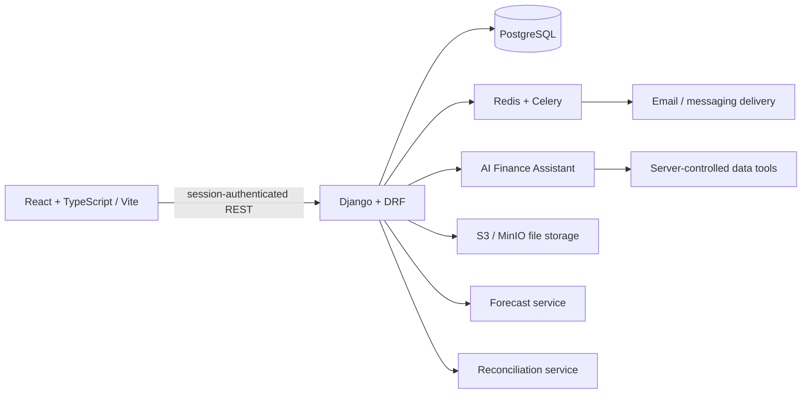

# Architecture

The backend is authoritative for money and organization access. A request identifies the active organization with `X-Organization-ID`; the server verifies an active membership and scopes every query to that organization. All money fields use integer minor units (paise for INR). Cross-currency arithmetic is not supported. Authentication uses Django sessions and CSRF protection.

## Implemented modules

| Module | App | Status |
|---|---|---|
| Core financial records | `core` | Complete — organizations, memberships, customers, invoices (with line items), payments, allocations, dashboard, aging, audit log |
| File import | `imports_app` | Complete — CSV/XLSX invoice import with validation, preview, commit; file storage abstraction (S3/MinIO) |
| Reminders | `reminders` | Complete — templates with placeholder validation, policies with auto-mode confirmation, job approval queue |
| Messaging | `messaging` | Complete — MessageLog model, dispatch task with final eligibility checks, exponential backoff retry |
| Reconciliation | `reconciliation` | Complete — bank transaction staging, deterministic + fuzzy matching, confirm/reject workflow |
| Forecasting | `forecast` | Complete — 3 scenarios, 3 timing assumptions, historical delay calculation, insufficient-history detection |
| AI assistant | `ai_assistant` | Complete — server-controlled tools, OpenAI integration with rule-based fallback, metadata-only logging |
| Notifications | `notifications` | Complete — in-app notification center with deduplication |
| Subscriptions | `subscriptions` | Models complete — plan definitions, subscription status, billing events |
| Platform admin | `platform_admin` | Complete — staff-only endpoints for org/user/audit management |
| Exports | `exports` | Complete — CSV export for invoices, customers, payments |

## Data flow

1. **Invoice creation**: Client submits subtotal/discount/tax → API calculates total → stored as integer paise → audit logged
2. **Payment recording**: Client submits amount + allocations → API validates each allocation ≤ invoice balance and sum ≤ payment amount → persisted atomically with `select_for_update()` → audit logged
3. **Dashboard**: Derived from issued invoices and their active (non-reversed) allocations — totals reconcile exactly with invoice records
4. **Aging**: Each qualifying invoice assigned to exactly one bucket based on days past due
5. **Forecast**: Qualifying invoices (issued, positive balance) assigned expected dates based on due date + timing assumption → 3 scenarios calculated
6. **AI assistant**: Question → server-controlled tools fetch authorized data → LLM (or rule-based fallback) composes answer → metadata logged (no content stored)

## Deferred integrations

Email provider credentials, WhatsApp Business API, billing provider (Stripe/Razorpay), and AI provider API key must be supplied as environment variables. The system degrades gracefully:
- Without email credentials: reminders are queued but not dispatched (console backend in dev)
- Without AI API key: rule-based fallback answers using pre-fetched tool data
- Without S3 credentials: file storage is best-effort (uploads may be skipped in local dev)
