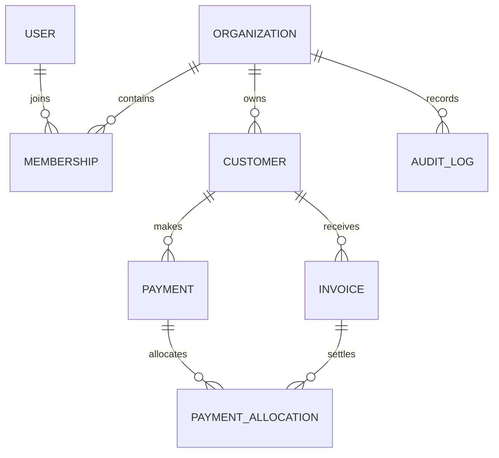

# Initial entity model

The Django schema is in `backend/core/models.py`. Public record IDs use UUIDs. Invoice numbers are unique within an organization. Customer archival is represented by an active flag; invoices and payments protect referenced customer records. Payment and allocation rows are not silently deleted through the API.

## Migration and rollback

Create schema migrations with `python manage.py makemigrations core` and apply with `python manage.py migrate`. Review each migration before applying it to shared data. Back up PostgreSQL before a production migration. Roll back only after checking whether the reverse operation would discard ledger or audit data; prefer forward corrective migrations for financial history.
